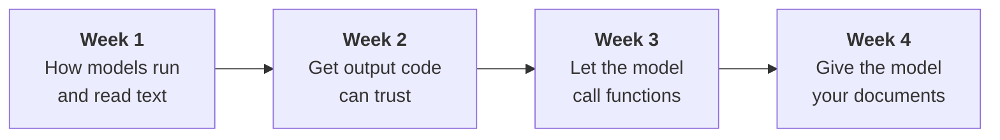

# AI Engineering Journey

> Learning AI engineering in public: **one project a week for 21 weeks**, using **local models** on a laptop.

Each week builds one small, working project **by hand first**, measures it with real numbers, and writes up what was learned so others can follow along.

- 🖥️ **Runs locally**: [Ollama](https://ollama.com) + Python. No API keys, no cloud bill.
- 🔧 **From scratch first**: frameworks only after the basics have been built by hand (week 6 onward).
- 📏 **Measured, not assumed**: every claim in the write-ups comes from a run you can reproduce.

---

## How to use this repo

Every week's folder has two documents:

| File | Read it if you want to… |
|---|---|
| 📘 **`LEARNINGS.md`** | **Learn the concepts**: step-by-step explanations, diagrams, examples, takeaways |
| 🛠️ **`README.md`** | **Run the code**: setup, commands, full results tables |

**New here?** Start with [Week 1 learnings](./week-01-model-bench/LEARNINGS.md) and go in order. Each week builds on the one before.

---

## Progress

| Week | Project | What you'll learn | Status |
|---|---|---|---|
| 01 | [Local Model Bench + Tokenizer](./week-01-model-bench/) | Prefill vs. decode, memory bandwidth, quantization, BPE tokenization, why Tamil costs more tokens than English | ✅ [Learnings](./week-01-model-bench/LEARNINGS.md) |
| 02 | [Structured Extractor](./week-02-structured-extractor/) | Schemas, validation, retry loops with error feedback, reasoning-model overhead | ✅ [Learnings](./week-02-structured-extractor/LEARNINGS.md) |
| 03 | [Tool-Calling Agent](./week-03-tool-agent/) | The agent loop, tool-call contracts, fake tool calls, stop sequences, safe execution | ✅ [Learnings](./week-03-tool-agent/LEARNINGS.md) |
| 04 | Docs Q&A (Naive RAG) | Chunking, embeddings, retrieval, citations | 🔜 Next |
| 05–21 | See the [roadmap](#roadmap) below | | ☐ |

---

## How the weeks connect



- **Week 1** found that models sometimes break JSON format (fences, wrong types).
- **Week 2** fixed that with schemas and a validate-and-retry loop.
- **Week 3** reused that structured output so the model can **ask for a tool**, the core of every agent.

---

## Getting started

**You'll need:**
- [Ollama](https://ollama.com) installed and running
- [uv](https://docs.astral.sh/uv/) for Python (projects use Python 3.14)
- ~8 GB free RAM for the 7B models

```bash
git clone https://github.com/rohini-vs/ai-projects.git
cd ai-projects/week-01-model-bench

uv sync
ollama pull llama3.2:3b
ollama pull qwen2.5:7b
```

Then follow that week's `README.md`. Each week is a self-contained `uv` project.

> **Note on hardware:** speed and memory numbers depend on your machine. The relative comparisons (3B vs 7B, Q4 vs Q8) should hold; the absolute numbers will differ.

---

## Roadmap

| Phase | Weeks | Projects |
|---|---|---|
| **1. Foundations** | 1–3 | Model bench + tokenizer · Structured extractor · Tool-calling agent |
| **2. Retrieval** | 4–6 | Naive RAG · RAG eval harness · Advanced RAG + LangChain / LlamaIndex |
| **3. Production** | 7–9 | Observability + guardrails + red-teaming · Event pipeline + cost controls · Serving at scale with vLLM |
| **4. Agents** | 10–14 | MCP server + text-to-SQL · Coding agent (LangGraph) · PR review bot · Research agent · Multi-agent "LLM council" |
| **5. Multimodal** | 15 | Vision + document understanding |
| **6. Fine-tuning** | 16–18 | LoRA/QLoRA · Embedding fine-tuning · DPO + distillation |
| **7. Voice + Capstone** | 19–21 | Voice pipeline · Personal "second brain" capstone |

---

## Principles

1. **Build it by hand before using a framework.** You can't debug what you don't understand.
2. **Test with tasks the model can actually fail.** Easy tests prove nothing.
3. **Measure everything.** Real numbers from real runs beat intuition.
4. **Write down what broke.** Failures teach more than successes, so every write-up includes them.

---

## Resources this journey leans on

**How LLMs work inside**
- [rasbt/LLMs-from-scratch](https://github.com/rasbt/LLMs-from-scratch)
- [karpathy/minbpe](https://github.com/karpathy/minbpe)

**Free courses**
- [Hugging Face LLM Course](https://huggingface.co/learn/llm-course/chapter1/1)
- [Hugging Face Agents Course](https://huggingface.co/learn/agents-course/en/unit0/introduction)
- [LLM Zoomcamp (DataTalks.Club)](https://datatalks.club/blog/llm-zoomcamp.html)

**Book**
- Chip Huyen, *AI Engineering*

---

Found a mistake, or got different numbers on your machine? Open an issue. Comparisons from other hardware are especially welcome.
