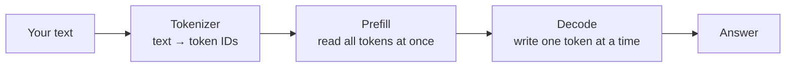
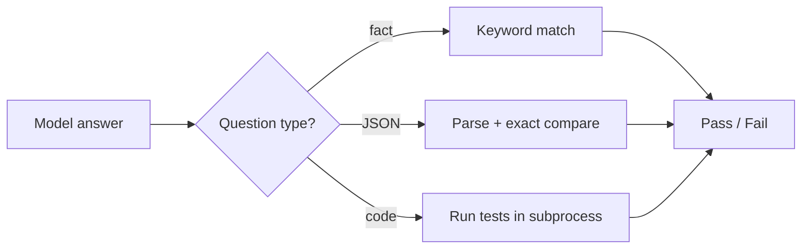
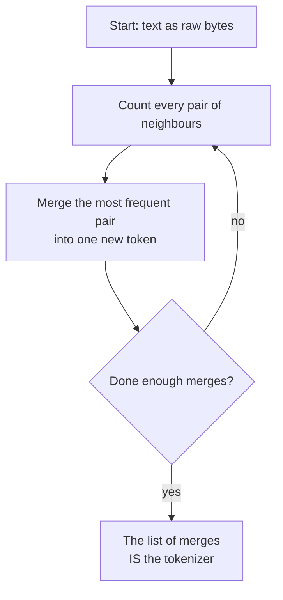

# Week 01 — How Local LLMs Run, and How Tokenizers Work

> **In one line:** we measure how fast and accurate local models really are, then build a tokenizer from scratch to see why some languages cost more to process.

Part of a [21-week, project-based path to AI engineering](../README.md) using local models. No frameworks: only the Ollama HTTP API and plain Python. Code and setup are in the [README](./README.md).

---

## What you'll learn

1. **Prefill vs. decode**: why a model reads fast but writes slowly
2. **Memory bandwidth**: what actually limits generation speed
3. **Quantization**: whether a compressed model is worse
4. **Automatic grading**: how to score answers without reading them all
5. **Tokenization (BPE)**: how text becomes tokens, and why Tamil costs more than English

**You need:** basic Python. No ML background assumed.

---

## The big picture

Every request to a model goes through the same pipeline. This week looks at each stage.



| Stage | Question we asked | Concept |
|---|---|---|
| Tokenizer | Why does the same sentence cost more tokens in Tamil? | 5 |
| Prefill + Decode | Which part is slow, and why? | 1, 2 |
| Answer | Is a smaller, compressed model less accurate? How do we check? | 3, 4 |

---

## Concept 1: Prefill vs. decode

### The idea

A model does two different jobs on every request:

| Phase | What happens | Speed |
|---|---|---|
| **Prefill** | Reads your whole prompt, all tokens **in parallel** | Fast |
| **Decode** | Writes the answer **one token at a time**; each token depends on the previous ones | Slow |

### What we measured

| Model | Prefill (reading) | Decode (writing) |
|---|---|---|
| llama3.2:3b | 511 tokens/sec | 50.3 tokens/sec |
| qwen2.5:7b (4-bit) | 259 tokens/sec | 24.3 tokens/sec |
| qwen2.5:7b (8-bit) | 282 tokens/sec | 21.8 tokens/sec |

Reading is about **10× faster** than writing on every model.

### Example

- Long prompt + short answer → feels fast
- Short prompt + long answer → feels slow

> **Takeaway:** to cut latency, shorten the *expected answer*, not the prompt.

---

## Concept 2: Speed is limited by memory, not "thinking"

### The idea

To write **each** token, the model has to read nearly **all** of its weights from memory. So the limit is how fast memory can move data:

```
max decode speed  ≈  memory bandwidth  ÷  model size
```

### Step by step

1. Look up your machine's memory bandwidth (spec sheet). Ours: ~200 GB/s.
2. Measure decode speed (tokens/sec).
3. Multiply decode speed × model size = bandwidth actually used.

### What we measured

| Model | Size in memory | Decode speed | Bandwidth used |
|---|---|---|---|
| llama3.2:3b | 2.3 GB | 50.3 tok/s | ~116 GB/s |
| qwen2.5:7b (4-bit) | 4.6 GB | 24.3 tok/s | ~112 GB/s |
| qwen2.5:7b (8-bit) | 7.8 GB | 21.8 tok/s | ~170 GB/s |

### A surprise

The 8-bit model came **closest** to the hardware limit, even though it's bigger.

One likely reason (not proven here): 4-bit weights have to be **unpacked** before use, which costs compute and cancels out part of the saving from moving less data.

> **Takeaway:** half the bits does **not** mean twice the speed. Measure it.

---

## Concept 3: Does compression (quantization) hurt quality?

### The idea

**Quantization** stores each weight with fewer bits:

| Version | Bits per weight | Memory | Expected quality |
|---|---|---|---|
| Q8 | 8 | larger | closer to original |
| Q4 | 4 | smaller | slightly worse? |

### What we measured

Same model (Qwen 2.5 7B), 8 auto-graded questions (facts, reasoning, code, JSON):

| Version | Score |
|---|---|
| Q4 (4-bit) | **8 / 8** |
| Q8 (8-bit) | 7 / 8 |

Q8's one miss was a **formatting** slip, not a reasoning error:

```json
{"price": "1499"}   ← returned (a string)
{"price": 1499}     ← expected (a number)
```

### Caveat

8 questions is tiny: one question = 12.5 points. This does **not** prove Q8 is worse. It shows Q8 cost **3.2 GB more** and ran **~10% slower** with **no measurable gain** on this test.

> **Takeaway:** use the cheaper option by default. Upgrade only when a real task shows it's needed.

---

## Concept 4: Grading answers automatically

### The idea

Reading 30 answers and deciding "looks right" doesn't scale. So each question type gets a simple automatic check:

| Question type | How it's checked |
|---|---|
| Fact / reasoning | Does the expected keyword appear in the answer? |
| JSON | Does it parse, and match the expected object **exactly**, types included? |
| Code | **Run it** against tests, e.g. `assert fib(10) == 55` |



The exact JSON compare is what caught the `"1499"` vs `1499` slip. A human skimming the output would probably have missed it.

### Where it breaks

- If a model answers **"eighty"** instead of **"80"**, the keyword check marks it wrong.
- Open-ended tasks (summaries) have no single right answer → we reviewed those by hand.
- The proper fix for open-ended tasks is **LLM-as-judge**, which a later week covers.

> **Takeaway:** automatic grading only checks what you told it to check. Know its blind spots before you trust its numbers.

---

## Concept 5: Tokenization, built from scratch

### The idea

Models don't read letters. They read **tokens**: chunks of text from a fixed vocabulary. That vocabulary is **learned** from training text using **Byte-Pair Encoding (BPE)**.

### How BPE works



The whole algorithm is two small functions:

```python
def get_stats(ids):                     # count neighbouring pairs
    counts = {}
    for pair in zip(ids, ids[1:]):
        counts[pair] = counts.get(pair, 0) + 1
    return counts

def merge(ids, pair, new_id):           # replace that pair with one new id
    out, i = [], 0
    while i < len(ids):
        if i < len(ids) - 1 and (ids[i], ids[i + 1]) == pair:
            out.append(new_id); i += 2
        else:
            out.append(ids[i]); i += 1
    return out
```

### Worked example: `"abcabcabd"`

**Start:** each letter is a byte (a=97, b=98, c=99, d=100)

```
a   b   c   a   b   c   a   b   d
97  98  99  97  98  99  97  98  100        → 9 tokens
```

**Round 1:** the most common pair is `(97, 98)` = "ab" (3 times) → becomes **256**

```
256  99  256  99  256  100                 → 6 tokens
```

**Round 2:** the most common pair is `(256, 99)` = "abc" (2 times) → becomes **257**

```
257  257  256  100                         → 4 tokens
```

**The trained tokenizer is just this:**

```python
merges = {(97, 98): 256, (256, 99): 257}
```

**Using it on new text `"abcabd"`:**

```
raw bytes:       97  98  99  97  98  100   (6)
apply ab→256:    256  99  256  100         (4)
apply abc→257:   257  256  100             (3)
```

Decoding reverses the merges and gives back `"abcabd"` exactly. Nothing is lost.

Real tokenizers do the same thing with **100,000+** merges instead of 2.

### Why Tamil costs more: the head start

UTF-8 encodes characters with different numbers of bytes:

| Language | Bytes per character |
|---|---|
| English | 1 |
| Tamil | ~3 |

So before any training, Tamil text is already **~2.7× longer** in bytes. We measured it: **1.00** tokens/char for English vs. **2.76** for Tamil.

### The experiment: languages competing for vocabulary

We trained 4 tiny tokenizers (256 merges each) and tested them on unseen text.
Tokens per character, **lower is better**:

| Trained on | English | Tamil |
|---|---|---|
| Nothing (raw bytes) | 1.00 | 2.76 |
| English only | **0.50** | 2.74 |
| Tamil only | 1.00 | **0.48** |
| Both mixed | 0.56 | 0.58 |

**Reading the table:**

1. **A tokenizer only gets good at what it saw.** English-only training halved English but did almost nothing for Tamil.
2. **When languages share a vocabulary, both lose a little:**
   - English: 0.50 → 0.56 (**~12% more tokens**)
   - Tamil: 0.48 → 0.58 (**~21% more tokens**)
3. **The smaller language loses more.** English made up more of the mixed training text, so it won more of the 256 merges.

### Why this matters in the real world

Real models are trained on mostly-English data. English wins most of the vocabulary. Tamil, Hindi and many other languages are left with more small byte-level pieces.

```
Same meaning  →  more tokens in Tamil  →  slower + more expensive
```

This isn't because the model "understands" Tamil less. Its **tokenizer** simply learned fewer shortcuts for it.

> **Takeaway:** token cost depends on the **training data mix**, not only on the language itself.

---

## Try it yourself

| Experiment | Command |
|---|---|
| Speed + memory benchmark | `uv run python src/bench.py --models llama3.2:3b,qwen2.5:7b` |
| Auto-grade the answers | `uv run python src/score.py` |
| English vs Tamil token count | `uv run python src/token_cost.py --models llama3.2:3b,qwen2.5:7b` |
| Train the 4 tiny tokenizers | `uv run python src/bpe_lab.py` |

Ideas to explore:
- Run the benchmark on your machine and compare it with your spec-sheet bandwidth.
- Add your own language to `data/` and rerun `bpe_lab.py`.
- Change the number of merges (256 → 1000) and see if the gap between English and Tamil shrinks.

---

## Key takeaways

- **Decode is the bottleneck.** Reading is ~10× faster than writing.
- **Speed ≈ bandwidth ÷ model size**, but quantization adds overhead, so measure it.
- **Q4 matched Q8** on our small test while using less memory. Start cheap.
- **Automatic grading** is fast and consistent, but blind to anything you didn't tell it to check.
- **BPE** is just "merge the most common pair, repeat." The training data mix decides which languages get cheap tokens.

---

## Glossary

| Term | Meaning |
|---|---|
| **Token** | A chunk of text the model reads/writes; can be a word, part of a word, or a byte |
| **Prefill** | Reading the prompt (parallel, fast) |
| **Decode** | Generating output one token at a time (sequential, slow) |
| **Quantization** | Storing weights with fewer bits (Q4 = 4-bit, Q8 = 8-bit) |
| **Memory bandwidth** | How many GB/s the machine can move between memory and processor |
| **BPE** | Byte-Pair Encoding: build a vocabulary by repeatedly merging the most frequent pair |
| **UTF-8** | The standard way to turn characters into bytes (1–4 bytes per character) |
