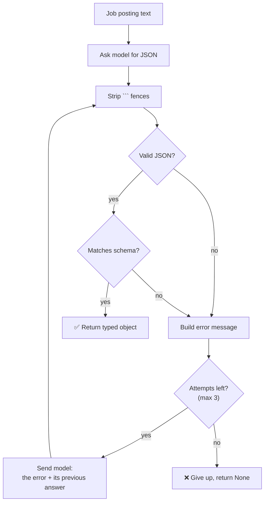

# Week 02 — Getting Reliable Structured Output from an LLM

> **In one line:** turn messy text into clean, typed data that a program can rely on, by validating every model response and retrying with the exact error when it's wrong.

Part of a [21-week, project-based path to AI engineering](../README.md) using local models. Code and setup are in the [README](./README.md).

---

## What you'll learn

1. **Why "just ask for JSON" isn't enough** in a real program
2. **Schemas**: describing exactly what a correct answer looks like
3. **Validation**: what it catches, and what it can't
4. **The retry loop**: feeding the specific error back to the model
5. **Reasoning models**: why their "thinking" cost must be measured

**You need:** basic Python. [Week 1](../week-01-model-bench/LEARNINGS.md) helps but isn't required.

---

## The problem

Week 1 showed that models sometimes break format, even when told not to:

````
```json                       ← wrapped in markdown fences
{"price": "1499"}             ← number returned as a string
```
````

In a chat window, that's harmless. In code, it crashes:

```python
data = json.loads(response)   # 💥 JSONDecodeError
```

**Goal:** a function that takes free text and **always** returns data in an exact shape, or fails clearly.

```
"Backend Engineer at Flexon, Chennai, 3-5 yrs, 12-18 LPA..."
                        ↓
JobPosting(title="Backend Engineer", company="Flexon Systems",
           min_experience_years=3, salary_min_lpa=12.0, remote=False, ...)
```

---

## The big picture



Each concept below covers one part of this loop.

---

## Concept 1: A schema describes the shape of a correct answer

### The idea

A **schema** is a contract: which fields must exist, and what type each one is. We use [Pydantic](https://docs.pydantic.dev/):

```python
class JobPosting(BaseModel):
    title: str
    company: str
    location: str
    min_experience_years: int
    max_experience_years: int
    salary_min_lpa: float
    salary_max_lpa: float
    remote: bool
```

### What it catches

| Model returned | Result |
|---|---|
| `"remote": true` | ✅ valid |
| `"remote": "maybe"` | ❌ not a boolean |
| missing `company` | ❌ field required |
| `"salary_min_lpa": "twelve"` | ❌ not a number |

---

## Concept 2: Validation checks **structure**, not **meaning**

### Example

On a clean posting, every field passed, including:

```json
"location": "Chennai office"     ← we wanted "Chennai"
```

It's a valid string, so the schema has nothing to complain about. Correct shape, imprecise content.

### How to close the gap

| Option | Example |
|---|---|
| Stricter type | an `Enum` of allowed cities |
| Pattern | a regex on the field |
| Separate meaning check | a rule, or a second model, reviews the content |

> **Takeaway:** passing validation means "the right shape," not "the right answer."

---

## Concept 3: Passing validation isn't proof of understanding

### The test

A deliberately ambiguous posting:

> *"open to remote for the right candidate but prefer Bangalore-based folks"*

Is that `remote: true` or `remote: false`? Honestly, it's neither.

### What happened (no retry yet)

| Model | `remote` returned | Validation |
|---|---|---|
| llama3.2:3b | `true` | ✅ passed |
| qwen2.5:7b | `"open to remote for the right candidate"` | ❌ failed |

### Reading it

- The model that **passed** made a **confident guess**.
- The model that **failed** kept the ambiguity, because the schema had no way to say "it depends."

A validator can't tell these apart. A good guess and a careful answer look the same once they're the right type.

> **Takeaway:** if your data can be ambiguous, design the schema for it (e.g. `remote: Literal["yes", "no", "hybrid", "unclear"]`).

---

## Concept 4: The retry loop: give the model the **specific** error

### The idea

Don't just say "try again." Tell the model **exactly** what was wrong.

### Step by step

**Attempt 1:** model returns

```json
{ ..., "remote": "open to remote for the right candidate" }
```

**Validation fails** with Pydantic's error:

```
1 validation error for JobPosting
remote
  Input should be a valid boolean, unable to interpret input
```

**Attempt 2:** we send back the error and the previous answer:

```
Your previous response had an error:
<the error above>

Your previous response was:
<its JSON>

Fix the error and return ONLY the corrected JSON object...
```

**Result:** qwen2.5:7b returned a real boolean → ✅ valid.

### Results with the retry loop

| Model | Easy posting | Hard posting |
|---|---|---|
| llama3.2:3b | ✅ 1 attempt | ✅ 1 attempt |
| qwen2.5:7b | ✅ 1 attempt | ✅ **2 attempts** |

> **Takeaway:** a precise error message is what makes a retry work. "Try again" alone gives the model nothing to fix.

⚠️ **Known gap:** we didn't log *which* boolean qwen2.5 picked on attempt 2. The retry fixed the **type**; we haven't checked whether the **value** was right.

---

## Concept 5: Measure a reasoning model's "thinking" cost

### The idea

Some models (like **Qwen3**) "think" privately before answering. That thinking costs tokens and time.

### What we expected

Give it a bigger token budget → it finishes thinking → it answers.

### What happened (qwen3:4b, simple extraction task)

| Token budget | Thinking used | Answered? |
|---|---|---|
| 300 | 300 (all of it) | ❌ |
| 1,200 | ~1,200 (all of it) | ❌ |
| 3,000 | ~3,000 (all of it) | ❌ |
| 4,500 | ~4,485 (all of it) | ❌ |

Thinking grew to fill **whatever budget we gave it**, on easy and hard postings alike. It never settled on an answer.

Three documented ways to turn thinking off (`think=False`, `/no_think`, empty `<think></think>` tags) also had no effect under Ollama. Full details are in the [README](./README.md#qwen34b--tested-and-excluded).

**Decision:** qwen3:4b was excluded from this week's comparison.

> **Takeaway:** test a reasoning model on *your* task before relying on it. More budget doesn't always mean it finishes.

---

## Try it yourself

| Experiment | Command |
|---|---|
| See the naive version fail | `uv run python src/naive_extract.py --model qwen2.5:7b` |
| Run the retry loop across models | `uv run python src/compare_extract.py --models llama3.2:3b,qwen2.5:7b` |

Ideas to explore:
- Make `location` an `Enum` and see whether `"Chennai office"` now triggers a retry.
- Change `remote: bool` to allow `"unclear"` and see what the models choose.
- Replace the specific error with a plain "try again" and compare how many attempts it takes.

---

## Key takeaways

- **Never trust raw model output in code.** Parse it, validate it, handle failure.
- **A schema checks shape, not truth.** `"Chennai office"` is a valid string.
- **Valid ≠ understood.** A confident guess passes as easily as a careful answer.
- **Specific errors make retries work.** Tell the model exactly what to fix.
- **Measure reasoning overhead** on your own task. Don't assume it's bounded.

---

## Glossary

| Term | Meaning |
|---|---|
| **Structured output** | Model output in a machine-readable format (usually JSON) with a fixed shape |
| **Schema** | A definition of required fields and their types |
| **Pydantic** | Python library that validates data against a schema and produces clear errors |
| **Validation error** | A message saying which field broke the schema and how |
| **Retry loop** | Re-asking the model, with the error, until it passes or attempts run out |
| **Reasoning model** | A model that generates hidden "thinking" tokens before its answer |
