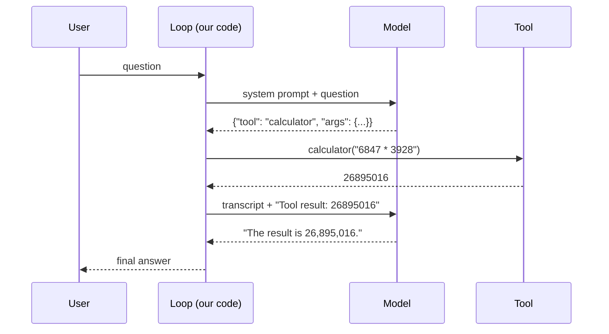
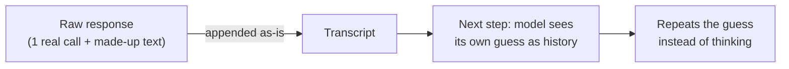

# Week 03 — Building a Tool-Calling Agent from Scratch

> **In one line:** let a model decide when it needs help, run a real function for it, and feed the real result back, all in a hand-written loop with no framework.

Part of a [21-week, project-based path to AI engineering](../README.md) using local models. Code and setup are in the [README](./README.md).

---

## What you'll learn

1. **What a "tool" is** and why models need them
2. **The tool-calling contract**: how a model asks for a function
3. **The agent loop**: call → run → feed back → repeat
4. **How to test it properly**: easy tasks prove nothing
5. **Fake tool calls**: how a model can pretend, and how code stops it
6. **Two bugs worth learning from**: stop sequences and a polluted transcript
7. **Running model-chosen code safely**

**You need:** basic Python. [Week 2](../week-02-structured-extractor/LEARNINGS.md) (structured output) is the foundation for this.

---

## Why tools?

Language models are good with language and unreliable at things like exact arithmetic:

```
Q: What is 6847 × 3928?
llama3.2:3b → 27,011,036   ❌ (confident, and wrong)
Actual      → 26,895,016
```

A calculator never gets this wrong. So instead of making the model better at maths, we let it **ask for a calculator**.

| The model is good at | Tools are good at |
|---|---|
| Understanding the question | Exact calculation |
| Deciding *what* to do | Counting, looking things up |
| Writing the final answer | Doing it correctly every time |

---

## Concept 1: The tool

A tool is a plain Python function:

```python
def calculator(expression: str) -> str:
    return str(eval(expression, {"__builtins__": {}}, {}))

def word_counter(text: str) -> str:
    return str(len(text.split()))

TOOLS = {"calculator": calculator, "word_counter": word_counter}
```

The model never runs these. **Our code** runs them when the model asks.

---

## Concept 2: The contract: how a model asks for a tool

The model can't call Python. It can only output text. So we agree on a format in the system prompt:

```
Available tools:
- calculator(expression: str)
- word_counter(text: str)

To use a tool, respond with ONLY this JSON:
{"tool": "<tool_name>", "args": {...}}

Once you have everything you need, answer in plain text.
```

Our code then reads each response:

| Model output | Meaning |
|---|---|
| `{"tool": "calculator", "args": {"expression": "6847 * 3928"}}` | "Please run this" |
| `The answer is 26,895,016.` | "I'm done" |

This is week 2's idea again: **structured output that code can act on.**

---

## Concept 3: The agent loop

### The flow



### Step by step

1. Send the model the instructions + question.
2. Read the response.
   - **JSON tool call?** → run that function for real.
   - **Plain text?** → that's the final answer. Stop.
3. Append the call and the **real** result to the transcript.
4. Go to step 1 with the longer transcript.
5. Stop after `MAX_STEPS` (4) so a confused model can't loop forever.

### The core code

```python
for step in range(1, MAX_STEPS + 1):
    response = generate(model, transcript)
    call = try_parse_tool_call(response)
    if call is None:
        return response                        # final answer

    result = TOOLS[call["tool"]](**call["args"])   # run it for real
    transcript += f"\n{json.dumps(call)}\nTool result: {result}\n"
```

Every agent framework (LangChain, OpenAI Agents, Claude tool use…) automates this same loop.

---

## Concept 4: An easy test proves nothing

### Example

| Task | llama3.2:3b | qwen2.5:7b |
|---|---|---|
| 847 × 23 | Answered directly ✅ `19,481` | Answered directly ✅ |
| 6847 × 3928 | Answered directly ❌ `27,011,036` | **Called calculator** ✅ `26,895,016` |

On the easy task, **neither model used the tool**. It looked like everything worked, but the tool code never ran.

Only the hard task forced a real decision.

### What the hard task showed

- **llama3.2:3b** didn't refuse or hesitate. It was **wrong with full confidence**.
- **qwen2.5:7b** recognised the task was beyond reliable mental maths and **delegated**.

The bigger model's advantage wasn't better arithmetic. It **knew when not to trust itself**.

> **Takeaway:** test with tasks the model would likely get wrong on its own. Otherwise you're not testing the tool path at all.

---

## Concept 5: A model can fake the whole tool conversation

### What happened

Asked *"How many words are in 'the quick brown fox jumps over the lazy dog', multiplied by 12?"*, the model wrote this **in one response**:

```
{"tool": "word_counter", "args": {"text": "the quick brown fox ..."}}
{"tool": "calculator", "args": {"expression": "word_counter(text) * 12"}}
There are 9 words in the sentence, and that number multiplied by 12 equals 108.
```

It wrote two tool calls **and** the final answer itself. No tool had run yet.

### Why that's dangerous

Our first parser tried to read the **whole** response as JSON. Two objects plus text isn't valid JSON, so it failed, and the whole thing was treated as a final answer.

```
Answer: 108   ✅ correct
Tools run: 0  ❌ by coincidence, not by design
```

A correct answer is **not** proof that a tool was used.

### The fix: only trust the first JSON object

```python
decoder = json.JSONDecoder()
data, _ = decoder.raw_decode(text)   # parse ONE object, ignore the rest
```

```
{"tool": "word_counter", ...}      ← parse and run this
{"tool": "calculator", ...}        ← ignore (invented)
There are 9 words...               ← ignore (invented)
```

The prompt says "respond with ONLY this JSON." Now **code** enforces that rule instead of hoping the model follows it.

> **Takeaway:** don't rely on the model to follow format rules. Enforce them in code.

---

## Concept 6: Two bugs worth learning from

### Bug 1: the stop sequence ate the closing brace

To cut the model off right after its JSON, we set a **stop sequence**:

```python
generate(..., stop=["}\n"])
```

The catch: Ollama **removes** the stop sequence from the output.

```
Model wrote:   {"tool": "word_counter", "args": {"text": "..."}}⏎
Stop matched:                                                   }⏎
We received:   {"tool": "word_counter", "args": {"text": "..."}     ← one } missing
```

The broken JSON didn't parse → the loop treated it as the **final answer** → the agent printed raw JSON and stopped.

It only showed up on the multi-step question. On the single-tool question, the model didn't put a newline after the JSON, so the stop never matched.

**Fix:** stop on the thing we actually want to prevent, the model **inventing its own tool results**:

```python
generate(..., stop=["\nTool result:"])
```

### Bug 2: the invented text was saved to the transcript

After running a tool, we appended the model's **entire raw response** to the transcript, including the invented second call and invented answer.



**Fix:** append only what we actually **parsed and ran**:

```python
transcript += f"\n{json.dumps(call)}\nTool result: {result}\n"   # not {response}
```

> **Takeaway:** the transcript is the model's memory. Only put **verified** things in it: the call you ran and the result you got.

---

## Concept 7: Models use tools selectively

After both fixes, the multi-step question runs like this:

| Step | What the model did | Real? |
|---|---|---|
| 1 | Called `word_counter` on the sentence | ✅ executed → `9` |
| 2 | Computed `9 × 12 = 108` itself | — no tool needed |

The model used a tool for what it can't do reliably (counting words exactly) and skipped it for trivial maths.

That's allowed: the prompt says *"answer directly if you don't need a tool."* To **force** a second call, use a harder number (e.g. ×7919) or require the calculator for all arithmetic.

---

## Concept 8: Running model-chosen code safely

`calculator` runs whatever string the model sends through `eval()`. Plain `eval()` runs **any** Python:

```python
eval("__import__('os').system('rm -rf ~')")   # 😱
```

So we strip everything except arithmetic:

```python
eval(expression, {"__builtins__": {}}, {})
```

| Input | Result |
|---|---|
| `"6847 * 3928"` | ✅ `26895016` |
| `"__import__('os')"` | ❌ `NameError` |
| `"open('secrets.txt')"` | ❌ `NameError` |

> **Takeaway:** a well-typed argument (it's a string ✅) can still be dangerous. Limit what the code can reach, not just its type.
>
> ⚠️ Empty builtins is a **minimum** safeguard, not a real sandbox. For production, use a proper expression parser instead of `eval`.

---

## Results

| Task | llama3.2:3b | qwen2.5:7b |
|---|---|---|
| 847 × 23 (easy) | Direct, correct | Direct, correct |
| 6847 × 3928 (hard) | Direct, **wrong** | Tool call, correct |
| Word count × 12 (multi-step) | Not tested | 1 real tool call + direct maths, correct |

---

## Try it yourself

```bash
uv run python src/test_loop.py --model qwen2.5:7b
uv run python src/test_loop.py --model llama3.2:3b
```

Ideas to explore:
- Change the multi-step question to "×7919" and see whether the model makes a second tool call.
- Add a new tool (e.g. `reverse_text`) and a question that needs it.
- Put `stop=["}\n"]` back and watch Bug 1 happen.
- Lower `MAX_STEPS` to 1 and see what breaks.

---

## Key takeaways

- **An agent is a loop:** model asks → code runs the tool → real result goes back → repeat.
- **Test with hard tasks.** Easy ones never touch the tool path.
- **Confident and wrong** is the most dangerous failure, because nothing signals it.
- **Models can fake tool use.** A correct answer doesn't prove a tool ran.
- **Enforce the contract in code:** parse the first JSON object, ignore the rest.
- **Know your stop sequences:** they're removed from the output.
- **Keep the transcript clean:** only verified calls and real results go in.
- **Limit what model-chosen code can reach.**

---

## Glossary

| Term | Meaning |
|---|---|
| **Tool** | A real function the model can ask our code to run |
| **Tool call** | The model's structured request, e.g. `{"tool": ..., "args": ...}` |
| **Agent loop** | Repeating model → tool → result until the model gives a final answer |
| **Transcript** | The growing conversation the model sees each step: its memory |
| **Stop sequence** | Text that makes generation stop; Ollama removes it from the output |
| **`raw_decode`** | Parses one JSON object from the start of a string and ignores the rest |
| **Step cap** | A maximum number of loop iterations, so the agent can't loop forever |
